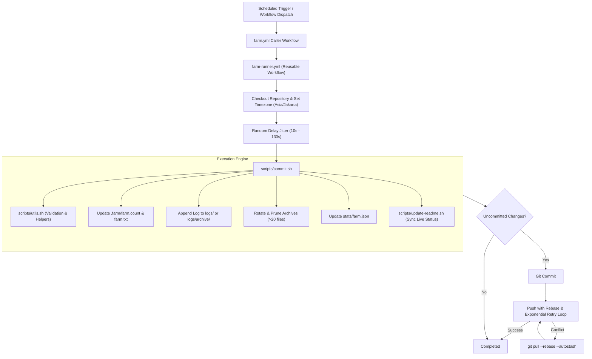

# 🌱 Graph Farm

<p align="center">
  
  
  
  
</p>

<p align="center">
  <strong>Production-ready, highly resilient GitHub contribution graph automation powered by modular GitHub Actions and lightweight Bash scripts.</strong>
</p>

---

## 1. Project Title & Description

**Graph Farm v2** is an automated repository activity generator engineered to execute scheduled, distributed commit operations via GitHub Actions. Built with strict resilience against concurrency collisions, automated log rotation, and live metrics synchronization, Graph Farm ensures reliable operation without requiring third-party runtime environments.

---

## 2. Project Overview

Graph Farm was designed with minimalism, predictability, and fault-tolerance in mind:
- **Zero Heavy Dependencies**: Runs purely on native POSIX shell utilities (`bash`, `awk`, `sed`, `date`, `find`, `sort`) and GitHub Actions runners.
- **Distributed Scheduling**: Distributes operations across 10 independently scheduled workflow jobs to minimize collision probability and simulate organic commit activity.
- **Self-Healing Git Pipeline**: Features an automated fetch-rebase retry mechanism to resolve concurrent push race conditions gracefully.
- **Automated Observability**: Maintains per-farm rotation logs, JSON metrics, and an automatically synchronized markdown dashboard.

---

## 3. Feature List

- 🚀 **10 Independent GitHub Actions Workflows**: Staggered across distinct 5-minute cron offsets.
- 🔄 **Reusable Workflow Core (`farm-runner.yml`)**: Eliminates code redundancy across workflow definitions.
- 🛡️ **Race Condition Protection**: Integrated `git pull --rebase --autostash` with exponential jitter retries.
- 🕒 **WIB Timezone Enforcement**: All timestamps are standardized to Asia/Jakarta (`UTC+7`).
- 📜 **Automated Log Rotation**: Automatically rotates logs into archives every 1,000 commits.
- 🧹 **Archive Pruning**: Retains up to 20 recent archive logs per farm using natural version sorting (`sort -V`).
- 📊 **Structured JSON Telemetry**: Outputs real-time execution statistics for each individual farm.
- 📖 **Self-Updating Live README**: Built-in script synchronizes live statistics directly into `README.md`.
- 🎲 **Randomized Jitter Delay**: Employs random execution sleep intervals (10s to 130s) to prevent lock-step bursts.
- 👤 **Configurable Git Identity**: Supports repository variables and secrets with fallback to `${{ github.actor }}`.

---

## 4. Live Project Status

<!-- FARM_STATUS_START -->

### 📊 Live Status

| Metric | Current Value |
|:---|:---|
| **Last Synchronized** | **2026-11-12 15:14:37 WIB** |
| **Active Timezone** | **Asia/Jakarta (WIB)** |
| **Total Farm Commits** | **11609** |

#### Per-Farm Performance Summary

| Farm | Commits | Last Run (WIB) | Active Log |
|:---|---:|:---|:---|
| Farm 1 | 1155 | 2026-11-12 09:27:56 WIB | `farm1-2.log` |
| Farm 2 | 1221 | 2026-11-12 10:21:03 WIB | `farm2-2.log` |
| Farm 3 | 981 | 2026-11-12 11:19:51 WIB | `farm3.log` |
| Farm 4 | 1384 | 2026-11-12 10:26:44 WIB | `farm4-2.log` |
| Farm 5 | 1005 | 2026-11-12 09:29:03 WIB | `farm5-2.log` |
| Farm 6 | 1143 | 2026-11-12 09:22:38 WIB | `farm6-2.log` |
| Farm 7 | 1185 | 2026-11-12 15:14:37 WIB | `farm7-2.log` |
| Farm 8 | 1112 | 2026-11-12 11:14:56 WIB | `farm8-2.log` |
| Farm 9 | 1307 | 2026-11-12 10:58:55 WIB | `farm9-2.log` |
| Farm 10 | 1116 | 2026-11-12 14:40:50 WIB | `farm10-2.log` |

<!-- FARM_STATUS_END -->

---

## 5. Project Architecture

The following diagram illustrates the lifecycle of a single farm invocation:



---

## 6. Directory Structure

```text
.
├── .farm/                       # Internal tracking data files
│   ├── farm1.count              # Plaintext commit counter for Farm 1
│   ├── farm1.txt                # Content file modified on every commit
│   └── ...                      # Counters and content files for Farms 2 through 10
│
├── .github/
│   └── workflows/
│       ├── farm-runner.yml      # Central reusable workflow engine (workflow_call)
│       ├── farm1.yml            # Caller workflow for Farm 1 (cron: */5 * * * *)
│       ├── farm2.yml            # Caller workflow for Farm 2 (cron: 1-59/5 * * * *)
│       ├── ...                  # Workflows for Farms 3 through 9
│       └── farm10.yml           # Caller workflow for Farm 10 (cron: 4-59/5 * * * *)
│
├── logs/                        # Active runtime log directory
│   ├── .gitkeep                 # Preserves directory in git tracking
│   ├── farm1.log                # Primary log file for Farm 1 (first 1,000 commits)
│   └── archive/                 # Rotated log archives
│       ├── .gitkeep             # Preserves archive directory in git tracking
│       └── farm1-2.log          # Archived log for commits 1,001 to 2,000
│
├── scripts/                     # Modular execution scripts
│   ├── commit.sh                # Main commit execution driver
│   ├── logger.sh                # Structured logging utility
│   ├── rotate.sh                # Log archive rotation and pruning utility
│   ├── update-readme.sh         # Live dashboard generator for README.md
│   └── utils.sh                 # Central helper library and input validator
│
├── stats/                       # Machine-readable telemetry files
│   ├── farm1.json               # Current statistics for Farm 1
│   └── ...                      # JSON statistics for Farms 2 through 10
│
├── .gitignore                   # Ignored temporary and environment files
├── LICENSE                      # MIT License
└── README.md                    # Project documentation and live status dashboard
```

---

## 7. Requirements & Prerequisites

### For GitHub Actions (Production)
- A GitHub repository (public or private).
- GitHub Actions enabled in repository settings.
- Workflow write permissions enabled (`contents: write`).

### For Local Development & Testing
- **Operating System**: Linux, macOS, or Windows (via Git Bash, WSL, or MSYS2).
- **Shell**: `bash` (version 4.0 or higher recommended).
- **Core Utilities**: `git`, `awk`, `sed`, `date`, `find`, `sort`.
- *Optional*: `jq` (if absent, `scripts/update-readme.sh` automatically falls back to built-in POSIX `grep`/`sed` parsing).

---

## 8. Installation Instructions

1. **Clone the repository**:
   ```bash
   git clone https://github.com/frhndevweb/graph-farm.git
   cd graph-farm
   ```

2. **Ensure executable permissions on all scripts**:
   ```bash
   chmod +x scripts/*.sh
   ```

3. **Verify local execution**:
   Test a single farm iteration locally without pushing:
   ```bash
   bash scripts/commit.sh 1
   ```

---

## 9. Configuration Guide

Graph Farm is configured to work out-of-the-box, but supports customization through environment variables or GitHub repository variables:

| Variable | Type | Description | Default Value |
|:---|:---|:---|:---|
| `GIT_NAME` | Secret / Variable | Git author display name for workflow commits | `${{ github.actor }}` |
| `GIT_EMAIL` | Secret / Variable | Git author email for workflow commits | `<actor>@users.noreply.github.com` |
| `TZ` | Environment | Target operational timezone | `Asia/Jakarta` |
| `MAX_ARCHIVES` | Shell Parameter | Maximum number of archived log files kept per farm | `20` |

To set custom author information for commits:
1. Navigate to **Settings** > **Secrets and variables** > **Actions** in your GitHub repository.
2. Under the **Variables** tab, add `GIT_NAME` and `GIT_EMAIL`.

---

## 10. GitHub Actions Setup

To enable automated commits, GitHub Actions requires explicit write permissions to your repository.

1. Go to your repository on GitHub.
2. Click **Settings** > **Actions** > **General**.
3. Scroll down to **Workflow permissions**.
4. Select **Read and write permissions**.
5. Check **Allow GitHub Actions to create and approve pull requests** (if applicable).
6. Click **Save**.

```text
Repository Settings -> Actions -> General -> Workflow permissions -> Select "Read and write permissions"
```

---

## 11. Workflow Documentation

### Reusable Core (`farm-runner.yml`)
The workflow at `.github/workflows/farm-runner.yml` handles the actual execution logic:
- Accepts `farm_id` (number) and `farm_name` (string) as required inputs.
- Configures git author details dynamically.
- Implements the retry loop with backoff for `git push`.

### Individual Callers (`farm1.yml` to `farm10.yml`)
Each farm workflow is declared individually to maintain separate triggers and GitHub Action history tabs:
```yaml
name: 🌱 Farm 1

on:
  schedule:
    - cron: "*/5 * * * *"
  workflow_dispatch:

permissions:
  contents: write

concurrency:
  group: farm1
  cancel-in-progress: false

jobs:
  farm:
    name: Farm 1
    uses: ./.github/workflows/farm-runner.yml
    with:
      farm_id: 1
      farm_name: "🌱 Farm 1"
    secrets: inherit
```

---

## 12. Scheduling & Timezone Explanation

All timestamps recorded in logs, stats JSON files, and commit messages are formatted in **WIB (Western Indonesian Time / Asia/Jakarta, UTC+7)**.

GitHub Actions schedules operate in **UTC**. The workflow crons are staggered across minute offsets to spread server load:

| Workflow | UTC Cron Expression | Execution Minutes (UTC) | Stagger Offset |
|:---|:---|:---|:---|
| **Farm 1** | `*/5 * * * *` | :00, :05, :10, :15, :20, :25, :30, :35, :40, :45, :50, :55 | Base (0 min) |
| **Farm 2** | `1-59/5 * * * *` | :01, :06, :11, :16, :21, :26, :31, :36, :41, :46, :51, :56 | +1 min |
| **Farm 3** | `2-59/5 * * * *` | :02, :07, :12, :17, :22, :27, :32, :37, :42, :47, :52, :57 | +2 min |
| **Farm 4** | `3-59/5 * * * *` | :03, :08, :13, :18, :23, :28, :33, :38, :43, :48, :53, :58 | +3 min |
| **Farm 5** | `4-59/5 * * * *` | :04, :09, :14, :19, :24, :29, :34, :39, :44, :49, :54, :59 | +4 min |
| **Farm 6** | `*/5 * * * *` | :00, :05, :10, :15, :20, :25, :30, :35, :40, :45, :50, :55 | Base (0 min + jitter) |
| **Farm 7** | `1-59/5 * * * *` | :01, :06, :11, :16, :21, :26, :31, :36, :41, :46, :51, :56 | +1 min + jitter |
| **Farm 8** | `2-59/5 * * * *` | :02, :07, :12, :17, :22, :27, :32, :37, :42, :47, :52, :57 | +2 min + jitter |
| **Farm 9** | `3-59/5 * * * *` | :03, :08, :13, :18, :23, :28, :33, :38, :43, :48, :53, :58 | +3 min + jitter |
| **Farm 10** | `4-59/5 * * * *` | :04, :09, :14, :19, :24, :29, :34, :39, :44, :49, :54, :59 | +4 min + jitter |

*Note: GitHub Actions scheduler may experience queue latency during peak platform loads. The embedded jitter delay (`10s` - `130s`) further ensures commits do not land on identical seconds.*

---

## 13. Logging System

The logging subsystem isolates records per farm and prevents unbounded disk growth.

### Rotation Mechanics
- Commits **1 to 1,000**: written to `logs/farm<N>.log`.
- Commits **1,001 to 2,000**: written to `logs/archive/farm<N>-2.log`.
- Commits **2,001 to 3,000**: written to `logs/archive/farm<N>-3.log`.
- Calculated index formula: `INDEX = ((COUNT - 1) / 1000) + 1`.

### Archive Pruning
When log rotation occurs, `scripts/rotate.sh` inspects `logs/archive/` and retains the latest **20** archive files for that farm, safely deleting older archives using version sorting (`sort -V`).

---

## 14. Statistics System

Each workflow run updates a dedicated JSON statistics file located in `stats/farm<N>.json`:

```json
{
  "farm": 1,
  "commits": 1144,
  "last_run": "2026-11-08 09:44:50 WIB",
  "log": "farm1-2.log"
}
```

Fields:
- `farm`: Farm ID integer.
- `commits`: Cumulative commit counter for this farm.
- `last_run`: Timestamp of the last successful run in Asia/Jakarta.
- `log`: Filename of the currently active log file.

---

## 15. Troubleshooting

### 1. `Push failed: 403 Forbidden`
- **Cause**: GitHub Actions workflow lacks write permissions to the repository.
- **Solution**: Go to repository **Settings** > **Actions** > **General** > **Workflow permissions** and choose **Read and write permissions**.

### 2. `Updates were rejected because the remote contains work that you do not have locally`
- **Cause**: Multiple farms attempted to push simultaneously.
- **Solution**: Handled automatically! The reusable runner executes `git pull --rebase --autostash origin main` and retries up to 5 times.

### 3. `scripts/update-readme.sh: jq: command not found`
- **Cause**: Running on a local environment without `jq` installed.
- **Solution**: `update-readme.sh` includes an automatic fallback to POSIX `grep`/`sed` extraction; no manual action is needed.

### 4. Workflow did not trigger on exact minute
- **Cause**: High GitHub Actions queue load.
- **Solution**: GitHub Actions cron jobs are best-effort and queued according to global runner availability. Staggered minutes and random delays help avoid peak minute bottlenecks.

---

## 16. Security Considerations

- **Least Privilege Permissions**: Workflows request only `contents: write`. No administrative, pull request, or secret management privileges are granted.
- **No Hardcoded Tokens**: Authenticates strictly via GitHub's ephemeral `secrets.GITHUB_TOKEN`.
- **Input Sanitization**: `scripts/utils.sh` validates that `farm_id` is an unsigned integer to prevent argument injection and syntax errors.
- **Branch Protection Safe**: If branch protection rules are applied to `main`, ensure GitHub Actions is granted bypass permissions or push to an authorized staging branch.

---

## 17. Frequently Asked Questions (FAQ)

### Can I manually trigger a single farm run?
Yes. Go to the **Actions** tab on GitHub, select any workflow (e.g., `🌱 Farm 1`), and click **Run workflow**.

### How do I modify the commit frequency?
Edit the `schedule` cron in `.github/workflows/farm<N>.yml`. For example, change `"*/5 * * * *"` to `"0 */2 * * *"` for execution every 2 hours.

### How do I reset commit counts?
Delete or edit the numbers inside `.farm/farm<N>.count` and update `stats/farm<N>.json`, then run `bash scripts/update-readme.sh` to refresh the dashboard.

---

## 18. License & Credits

- **License**: Released under the [MIT License](LICENSE).
- **Author**: [Farhan Hanafi (frhndevweb)](https://github.com/frhndevweb).
- Made with ❤️ and automated with GitHub Actions.
